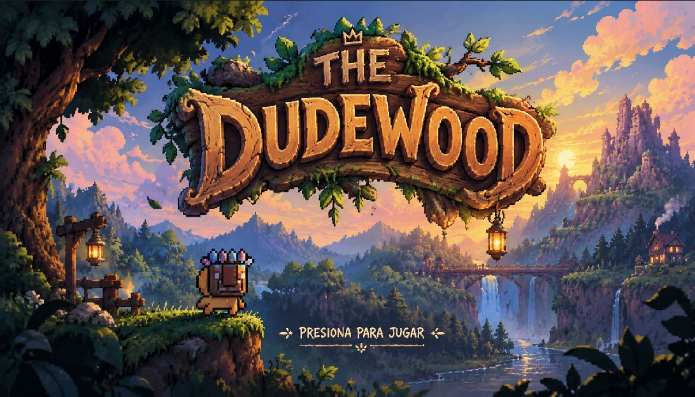
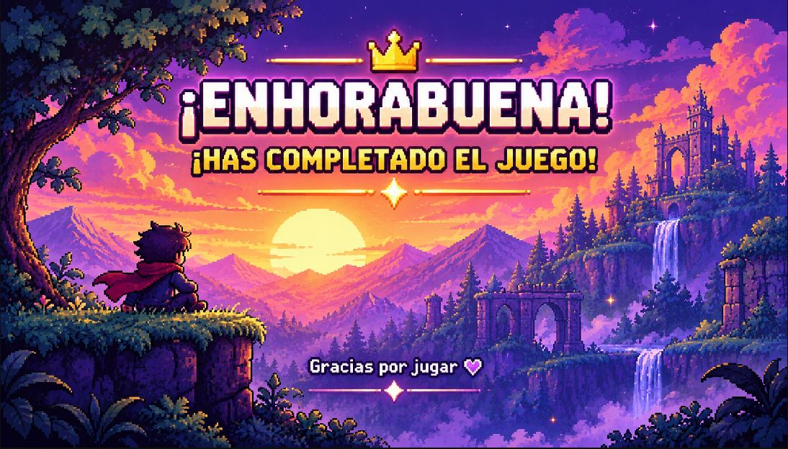
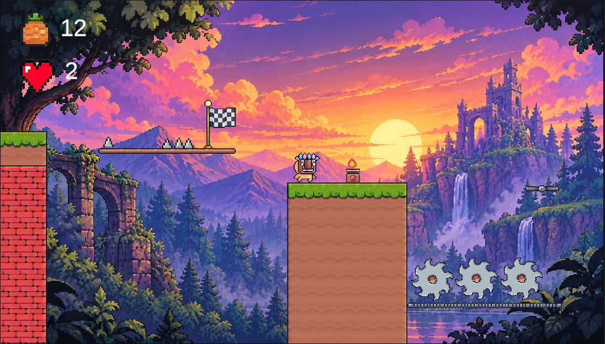
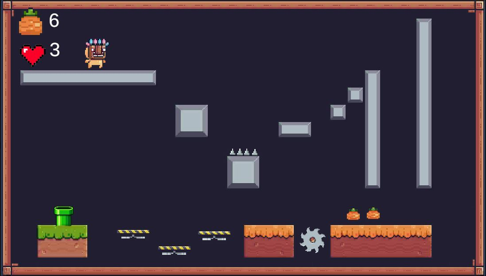
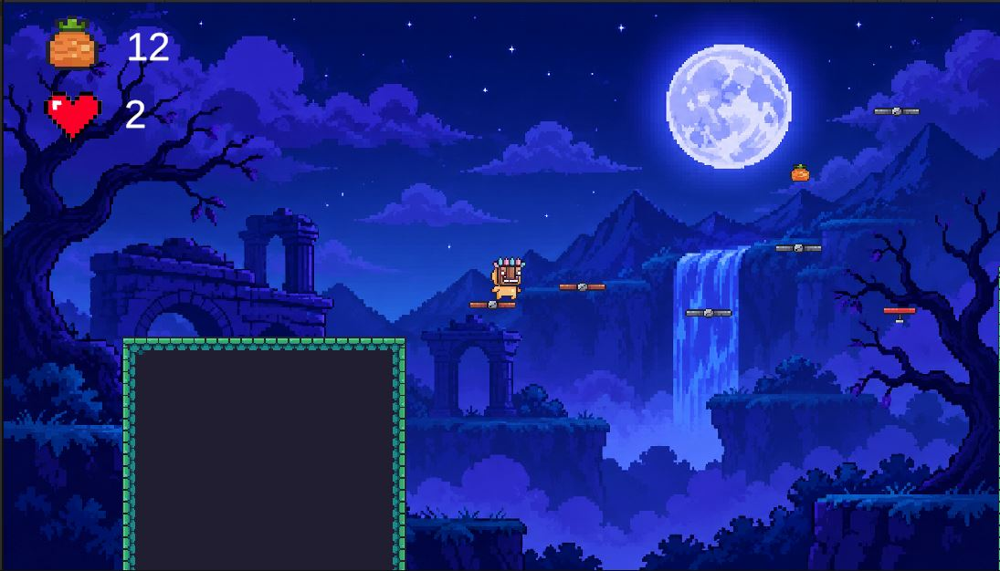

# The Dudewood

**Autor:** Mario Rodriguez Lopez

## Descripción del juego

The Dudewood es un videojuego de plataformas 2D en el que controlamos a Mask Dude, un personaje que debe avanzar por diferentes escenarios, superar obstáculos y evitar trampas y enemigos.

Durante la aventura podremos recoger frutas, realizar saltos dobles y utilizar puntos de control para continuar nuestro recorrido. El juego cuenta con diferentes niveles y elementos que hacen que cada escenario suponga un nuevo desafío.

## Capturas del juego

### Pantalla de inicio

### Pantalla de fin

### Nivel 1

### Subnivel

### Nivel 2

